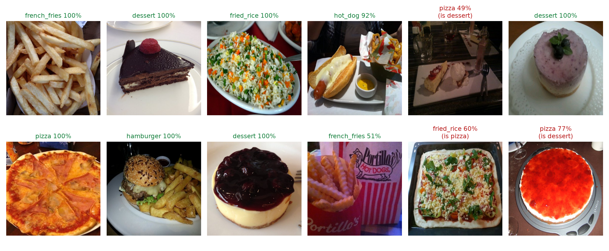
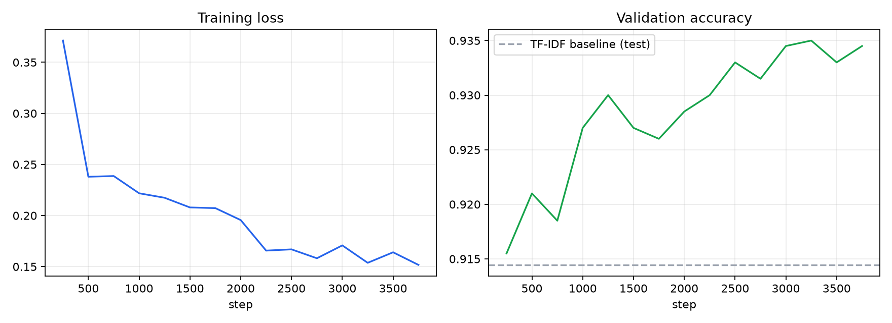

# computer_vision

Course work on computer vision and NLP: OpenCV and PyTorch notebooks, and two small projects trained end to end.

| Project | Task | Model | Result |
|---|---|---|---|
| [Menu Detector](menu_detector) | name the dish in a photo, 6 classes | MobileNetV2, transfer learning | 95.7% accuracy on 1,750 test photos |
| [Review sentiment](review_sentiment) | positive / negative for Korean shopping reviews | klue/roberta-small, fine-tuned | 93.2% accuracy, F1 0.932 on 20,000 test reviews |

## Menu Detector

Continues `menu_detector_model.ipynb`. MobileNetV2 pretrained on ImageNet gets a new 6-class head
(hamburger, hot dog, pizza, french fries, fried rice, dessert — chocolate cake and cheesecake share the
dessert label). The head is trained for 2 epochs with the backbone frozen, then the whole network is
fine-tuned for 6 epochs at a tenth of the learning rate.

- Data: Food-101, its own split — 4,750 training photos, 500 for validation, 1,750 for the test.
- Test accuracy 95.7%; per class from 88.8% (hot dog) to 98.8% (pizza).
- 6.5 minutes of training on an Apple M3 Pro GPU.



```
python menu_detector/train.py            # trains and writes results/
python menu_detector/train.py --eval-only  # redraws the figures from the saved weights
python menu_detector/predict.py photo.jpg
```

## Review sentiment

A Korean RoBERTa encoder fine-tuned to tell a positive shopping review from a negative one.

- Data: 200,000 Naver shopping reviews with star ratings (4-5 positive, 1-2 negative), from
  [bab2min/corpus](https://github.com/bab2min/corpus). 60,000 for training, 20,000 held out for the test.
- Baseline on the same split: TF-IDF character n-grams + logistic regression, 91.4%.
- Fine-tuned model: 93.2% accuracy, F1 0.932 (2 epochs, AdamW 3e-5, 64 tokens).
- The most confident mistakes are label noise: complaints that were posted with 4-5 stars.



```
python review_sentiment/train.py
python review_sentiment/predict.py "배송 빠르고 좋아요" "사이즈가 안 맞아요"
```

## Setup

```
python3 -m venv .venv && .venv/bin/pip install torch torchvision transformers scikit-learn matplotlib pandas pillow
```

Datasets go under `data/` (not in git): `data/food-101/` (Food-101 archive unpacked) and
`data/reviews/naver_shopping.txt`. Trained weights are written to `runs/`.

## Notebooks

`cv_opencv.ipynb` (image basics and face detection with a Haar cascade), `matplotlib.ipynb`,
`pytorch.ipynb` (tensors, a first training loop), `menu_detector_model.ipynb` (the first draft of the Menu Detector).
